<div align="center">

  <!-- Bannière SVG Animée Cyber-Noir -->
  

  <br/><br/>

  <p align="center">
    <b>AI Engineering Student &bull; Machine Learning &bull; Computer Vision &bull; LLM Architectures</b>
  </p>

  <p align="center">
    <a href="https://github.com/Ahmed-BenGhanem"></a>
    <a href="mailto:kalibouhmid15@gmail.com"></a>
  </p>
</div>

---

### 🧠 Core Neural Arsenal

```
├── Languages        : Python, C++, SQL, Bash
├── AI & Deep Learning: PyTorch, TensorFlow, Scikit-Learn, Hugging Face, OpenCV
├── Generative AI    : Transformers, LangChain, LlamaIndex, Ollama
└── DevOps & MLOps   : Docker, Git, Linux, Weights & Biases
```

<br/>

### 🔬 Focus & Research Areas
- 🔭 **Deep Learning & Computer Vision:** Object detection, semantic segmentation, Vision Transformers (ViT).
- ⚡ **Generative AI & LLM Systems:** Multi-agent architectures, RAG pipelines, and model fine-tuning.
- ⚙️ **Production AI:** Deploying performant, low-latency machine learning models into real-world software.

<br/>

<div align="center">
  <sub>⚡ Designed with pure animated SVGs &bull; Zero external latency &bull; Hosted on GitHub</sub>
</div>
