<!-- Every card is an animated SVG drawn by scripts/render_readme_cards.py and refreshed daily
     by .github/workflows/update-profile-art.yml. Design: "Three Worlds", customized for Ahmed Ben Ghanem (Ahmed BG).
     Spacing is baked into the SVGs, so keep this block free of blank lines and keep the cards in
     a row on one line with no spaces between them. -->

 
 
 
 
<picture><source media="(prefers-color-scheme: dark)" srcset="./cards/title-coding-dark.svg" /></picture> 

<a href="https://github.com/Ahmed-BenGhanem">github.com/Ahmed-BenGhanem</a> &nbsp;/&nbsp; <a href="mailto:kalibouhmid15@gmail.com">email</a> &nbsp;/&nbsp; <a href="https://github.com/Ahmed-BenGhanem/Ahmed-BenGhanem/blob/main/ahmed-ascii.svg">live ascii terminal</a>

